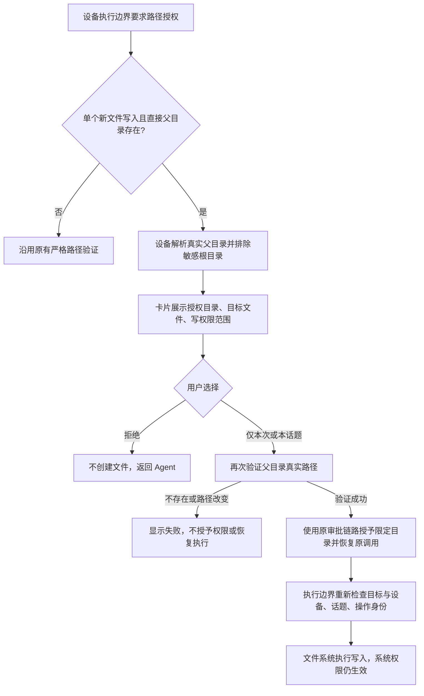

# 新建文件路径授权验收用例

环境：本地 Electron 测试版，独立测试 profile，仅连接 mlai-test.bielcrystal.com。全部使用合成文件。记录客户端 commit、服务端版本、设备、话题、operationId 和时间；截图和日志对外分享前遮盖实际路径。不得使用生产账号数据或真实业务文件。

准备：创建三个互不包含的合成目录 A（工作目录）、B（外部输出目录）、C（对照目录）。B 下新文件不得预先存在。手动批准模式；提示 Agent 使用 createOfficeDocument 或 writeFile，避免 shell 命令替代掩盖路径授权。每项使用独立话题，检查文件实际落盘与内容，不能仅凭 Agent 文本判断成功。

| 编号 | 真实点击步骤                                                             | 预期及日志核对                                                                                   |
| ---- | ------------------------------------------------------------------------ | ------------------------------------------------------------------------------------------------ |
| 01   | 新话题，选择临时工作目录；要求在临时目录创建 Word                        | 正常创建，不出现额外路径授权                                                                     |
| 02   | 新话题选择 A；要求在 A 创建 Word                                         | 正常创建，不出现额外路径授权                                                                     |
| 03   | 临时目录话题，要求在 B 创建新的 Word；点击仅本次批准                     | 卡片分别显示目标文件和授权目录 B、写权限；批准后原调用恢复，文件实际创建，批准状态和运行状态结束 |
| 04   | A 话题，要求在 B 创建新的文本文件；仅本次批准                            | 与 03 相同；工作目录保持 A                                                                       |
| 05   | 完成 04 后新一轮要求在 B 创建另一个文件，再要求写 C                      | 仅本次权限不跨操作，B/C 均需重新授权                                                             |
| 06   | 新话题请求 B 新文件，选择本话题批准；下一轮在 B 新建另一个文件；再请求 C | B 可复用，C 仍需授权；工作目录不改变；另一个话题不继承 B                                         |
| 07   | 请求 B 新文件，在卡片点击拒绝                                            | 不创建文件、不保存授权，Agent 能继续给替代方案；随后在 A 生成成功                                |
| 08   | 请求 B/不存在的子目录/文件.docx                                          | 不自动回退授权 B 或 HOME，不自动创建目录；失败可理解且可恢复                                     |
| 09   | 请求读取 B/不存在.txt                                                    | 仍提示不存在，不转换为父目录授权后读取成功                                                       |
| 10   | 准备卡片后移走 B；批准；恢复 B 后重试                                    | 校验失败时不记录成功、不恢复执行；恢复后可重新批准                                               |
| 11   | 准备卡片后将 B 替换为指向 C 的链接，再批准                               | 路径变化不静默扩大权限；不写入 C；Windows 联接也需验证                                           |
| 12   | B 撤销写权限，批准创建；恢复权限后重试                                   | 权限错误与不存在区别；不虚报成功；恢复后可继续                                                   |
| 13   | 远程设备生成卡片后断开设备；批准；重新连接再重试                         | 设备不可用不记成功；重连后恢复正确设备的调用                                                     |
| 14   | 自动批准模式，A 话题写 B 新文件                                          | 普通写入沿用自动批准；无新增路径弹窗；敏感路径和 shell 限制仍有效                                |
| 15   | 远程模式重复 03/06/07；本机重复一次                                      | 服务端恢复与本地恢复一致；operation/device/topic 绑定不串话题                                    |
| 16   | 读取已有文件、已有目录授权、批准普通工具、拒绝普通工具                   | 原交互正常；本修复不改变非新建文件路径                                                           |
| 17   | 话题授权后撤销，再请求 B 文件                                            | 重新要求批准；权限撤销生效                                                                       |
| 18   | 未升级客户端/服务端处理旧版卡片                                          | 旧卡片不猜父目录，不静默扩大权限；保留原严格语义                                                 |

每轮综合核对：开发者工具 console/network 无未处理异常；日志 request/approval/resume 的设备和话题一致；只记录必要错误码及关联 ID；无重复恢复、重复创建或永久运行；审批失败不出现成功状态。执行边界再次检查最终路径。批准目录明确展示，权限不增加 exec。不要更改系统保护或自动批准配置来绕过失败。

实施后在 PR 中逐项记录通过、失败、未执行及原因。Windows 专有联接测试不能由 macOS 单测替代。

2026-10-30 实际验收记录：基于 main `42cec56e`；macOS 本地 Electron 开发测试版，独立 `test-server` profile，连接 `https://mlai-test.bielcrystal.com`，禁用自动更新。未部署服务端，未连接生产环境。仅启动一份测试 App，验收后退出释放资源。测试服务端构建版本未独立采集。

| 测试话题           | 实际点击与文件核对                                                                                                                                                               | 结果                                                                                                                               |
| ------------------ | -------------------------------------------------------------------------------------------------------------------------------------------------------------------------------- | ---------------------------------------------------------------------------------------------------------------------------------- |
| `tpc_ZFPs32oB7U7Z` | 无工作目录的绝对路径新 Word：批准 B/accept-one.docx；下一轮 B/accept-two.docx 再次出现卡片，选择本话题记住；B/accept-three.docx 无新路径卡片；C/rejected.docx 出现独立卡片并拒绝 | 通过。三个 Word 解包检查正文，拒绝的文件不存在；覆盖仅本次、话题记忆与 B/C 范围关系                                                |
| `tpc_6cDeHM93xZS9` | 系统文件夹选择框选择 A；A/bound-inside.docx 无额外路径卡片；B/bound-external.txt 经普通工具批准及父目录批准后创建；切换自动批准创建 C/auto.docx，随后恢复手动批准                | 通过。正文及文本内容实际核对，A 绑定保持不变；新话题没有继承上一话题的 B 授权                                                      |
| `tpc_Z2rac9RaAY7Q` | 不使用项目，writeFile 相对路径创建 scratch-inside.txt；临时目录外创建 B/scratch-external.docx，点击仅本次                                                                        | 通过。临时目录自动建立、相对文件在临时目录内；外部 Word 批准后落盘，临时目录绑定不改变                                             |
| 同上               | 请求 C/missing-parent/new.docx，点击仅本次，再拒绝                                                                                                                               | 通过。显示路径不存在，未回退到 C，未创建 missing-parent；拒绝后可继续下一轮                                                        |
| 同上               | 准备 SwapB/changed.docx 卡片；将合成目录 SwapB 移走并改为指向 SwapC 的链接；点击本话题记住；恢复原目录后点击仅本次                                                               | 通过。链接变更时显示无法验证路径、不恢复执行，SwapC 无输出；原目录恢复后创建成功，正文已核对。仅验证 macOS 符号链接                |
| 同上               | 合成 Denied 目录设为无写权限；批准创建 no-write.docx；恢复权限，再发起新操作并批准                                                                                               | 写入失败与恢复通过。首次 EACCES，无目标文件及临时残留；恢复后 Word 正文为 PERMISSION_RECOVERED_OK。Agent 追加读取另有下述观察      |
| 同上               | 错误后在话题临时工作目录创建 recovery-final.docx，要求只用 createOfficeDocument                                                                                                  | 通过。正文 FINAL_RECOVERY_OK，界面正常结束。此前一次 recovery-inside.docx 已落盘，但测试操作中中断了回复，因此不作为正常结束的依据 |

额外观察：权限恢复后的 Word 写入成功，Agent 自行追加的 `readOfficeDocument` 返回 `SCOPE_DENIED`，随后如实报告无法独立回读；验收端解包确认文件存在且正文正确。读取/续跑链路不在本次修复范围，不能根据 Agent 文本认定文件未创建，也不能把该现象认定为本次引入。需要另行核对审批恢复时 operation 身份与旧 accessRoots；没有为绕过该问题扩大权限。其余多个 Word 用例的追加回读正常。

开发者工具检查可见 React 19 ref、antd 弃用、开发检查器 Fragment 属性等告警；Vite 日志可见 ResizeObserver 循环通知。未因本次路径审批出现窗口崩溃或永远运行。没有更改这些模块，也没有新增包含用户原始路径的 console 日志。

未完成真实点击的项目：09 不存在文件的读取、10 审批时目录单纯消失、13 远程设备断线、15 跨设备、17 撤销话题授权、18 独立旧服务端部署组合，以及 Windows 联接。09/18 的严格语义和解析兼容由定向测试部分覆盖，不能替代对应平台或服务组合的人工验收。

自动检查：

- 桌面控制器集成测试 26 项通过；新建文件目录及原执行边界 48 项通过；卡片、审批事务、服务端审批证据与恢复 38 项通过，共 112 项。
- 用新建 Word 控制器用例对比未修复的 main：预期父目录，实际返回不存在的文件路径，稳定失败；恢复修复后通过。
- 根项目 `bun run type-check` 通过。桌面独立检查与相同依赖的隔离 main 源码均为 166 个 TypeScript 诊断，规范化行列位置后诊断集合及重复次数完全相同，本次没有新增诊断。未修改既有桌面类型错误涉及的模块。
- 主语言资源校验 56,150 项键/占位符检查通过，语言启动回归 12 项通过；按当前 CI 契约补齐了越南语的两个新增文案。

最终授权链路如下；`requestedPath` 继续作为授权依据，新增 `requestedFilePath` 仅用于显示，不作为权限来源。

